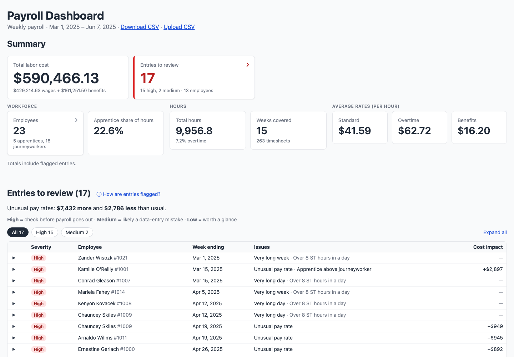

# Payroll Dashboard

A dashboard that helps a construction project manager understand weekly payroll at a glance and catch entries that look like data-entry errors before payroll goes out.

**Stack:** Vite · React · TypeScript · PapaParse · Vitest. Runs entirely in the browser; no backend.



## Quick start

Requires Node 20.19+ or 22.12+.

```bash
npm install
npm run dev      # http://localhost:5173
npm test         # unit tests
npm run build    # type-check + production build
```

The dashboard loads `public/payroll_data.csv`. **Upload CSV** in the header analyzes another file with the same columns, and **Download CSV** gets the source file, so the "line N" references in flagged entries can be looked up.

## What's on the dashboard

The page answers a project manager's questions in order: *what did we spend?*, *is anything wrong?*, *who should I look into?*

1. **Summary:** total labor cost and entries to review, then headcount, apprentice share, hours and average rates.
2. **Entries to review:** flagged rows by severity, with plain-English reasons and cost impact; click a row for details.
3. **Employees:** sortable table of min / avg / max hours per day and rates for each employee, most-flagged first.

## Approach and prioritization

1. **Profiled the data before writing anything.** I checked data quality and the distributions of hours and rates, so every anomaly threshold rests on evidence and the expected results were known in advance.
2. **Correct, tested calculations next.** Parsing, stats and anomaly rules are pure functions in `src/lib/`, tested against the real file and against totals computed independently.
3. **Then the three required sections,** kept simple, then usability for a non-technical user: page order, cost impact, expandable explanations and plain language.
4. **Documented decisions and client questions as I went** in [DECISIONS.md](DECISIONS.md) and [QUESTIONS.md](QUESTIONS.md).

Deliberately cut for time: deployment, charts, a "this week" view and a backend (see [What I'd do next](#what-id-do-next)).

## How anomalies are defined

Thresholds come from the real distributions and live in [`src/lib/thresholds.ts`](src/lib/thresholds.ts).

| Rule | Flags when | Severity | Rows |
|---|---|---|---|
| Unusual pay rate | Standard rate is more than 20% from the employee's **median** rate | high | 6 |
| Very long week | More than 60 hours | high | 4 |
| Very long day | More than 16 hours in one day | high | 4 |
| Over 8 ST hours in a day | The extra hours should probably have been overtime | medium | 8 |
| Apprentice above journeyworker | Apprentice is paid more than the typical journeyworker in the same trade | medium | 2 |
| Name mismatch | Name differs from the one usually used for that ID; high if the first name differs (possibly a different person) | medium / high | 3 |

**Safety-net checks** that find nothing in this file but protect future uploads: duplicate weeks, overtime rate below standard, overtime with no standard hours, very short weeks (under 8 hours) or days (under 2 hours), one name under several IDs, non-Saturday week endings, and invalid values (excluded from totals).

On the sample file this flags **17 entries**, each matching an issue found by hand while profiling.

**Deliberately not flagged:** weekend work, weeks over 40 standard hours, and missing weeks. All three are common in this data, so they look like normal patterns on this project rather than errors.

## Key decisions

- **Median, not mean, for each employee's usual rate.** One spike week would drag a mean toward itself and partly hide the spike. The summary's averages are weighted by hours, so they match what was actually paid per hour.
- **Bad rows are excluded and reported, never patched.** Totals include flagged-but-valid rows, and the page says so.
- **Hours are rounded when parsed; money only when displayed.** Adding decimals in JavaScript drifts (`40.89999999999999`), which could flip a "> 60 hours" check.
- **Minimal dependencies and no backend.** 263 rows don't need a server; a sortable table is plain React state.

Full reasoning and known limitations are in [DECISIONS.md](DECISIONS.md). Questions I'd ask the client (daily vs weekly overtime, mid-project raises are in [QUESTIONS.md](QUESTIONS.md).

## Project structure

```
src/
  lib/                 pure logic, no React
    parse.ts           CSV parsing, validation, per-row hour and pay totals
    anomalies.ts       one function per anomaly rule, rule labels, grouping by row
    stats.ts           summary and per-employee stats
    thresholds.ts      every anomaly threshold
    format.ts, math.ts display formatting; median / groupBy / rounding
    *.test.ts          unit and real-data tests
  components/          SummaryCards, AnomalyTable, EmployeeTable, FlagRules
  App.tsx              loads the CSV, runs the pipeline, lays out the page
public/payroll_data.csv
```

## Testing

`npm test` runs the Vitest suite:
- **Each anomaly rule:** a case that should be flagged and one just past the threshold that shouldn't.
- **The real file:** each rule flags the exact (employee, week) rows found during profiling, not just the right number.
- **Summary and employee stats:** checked against totals computed independently with a plain Node script.
- **Parsing:** bad dates; blank, non-numeric and negative values; extra columns; and float drift at the 60-hour boundary.

## What I'd do next

- **A "this week" view.** The project manager checks payroll weekly before it goes out, so default to the latest week instead of the whole project.
- **"This week vs usual" table for pay-rate entries:** standard, overtime and benefits rates side by side with the employee's usual rates and the cost difference.
- **Pattern hints across employees.** Both Painters' rates dropped about 47% in the same week (04/19/2025), which points to one batch-entry error rather than two.
- **A "mark as reviewed" state and comments,** saved with a small backend, plus history across uploads.
- **A rate baseline that handles approved mid-project raises,** and a check that overtime is about 1.5× the standard rate.
- **Clearer upload errors:** one "missing column" message instead of an error on every row.
- **Employee drill-down, charts** (weekly labor cost, hours by trade), **a phone layout** for the entries table, and **deployment** as a static site.
- **Collapse the overtime and benefits columns** behind a toggle in the employee table. They mostly mirror the standard rate (overtime is always 1.5×), but the brief asks for min/avg/max of all three, so they stay for now.
